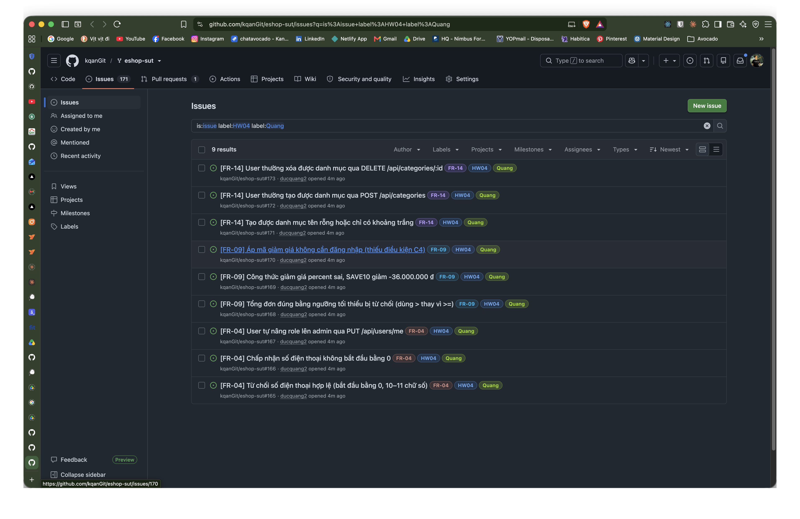
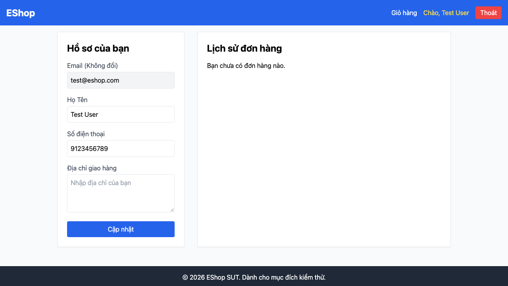
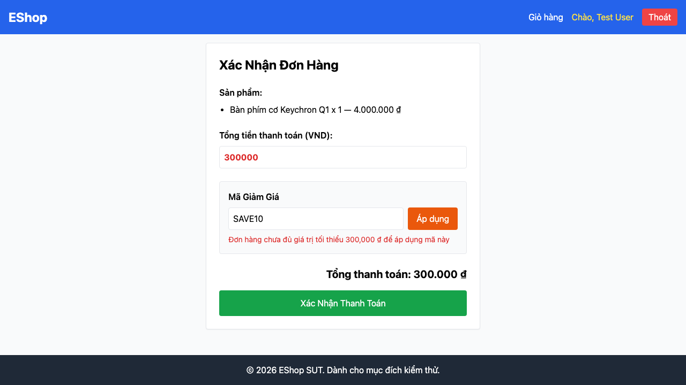
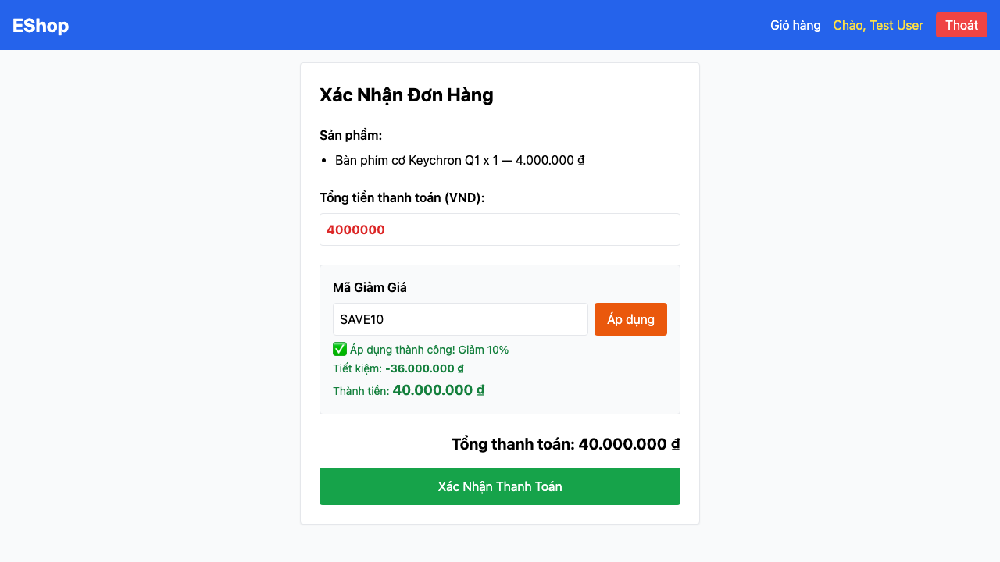
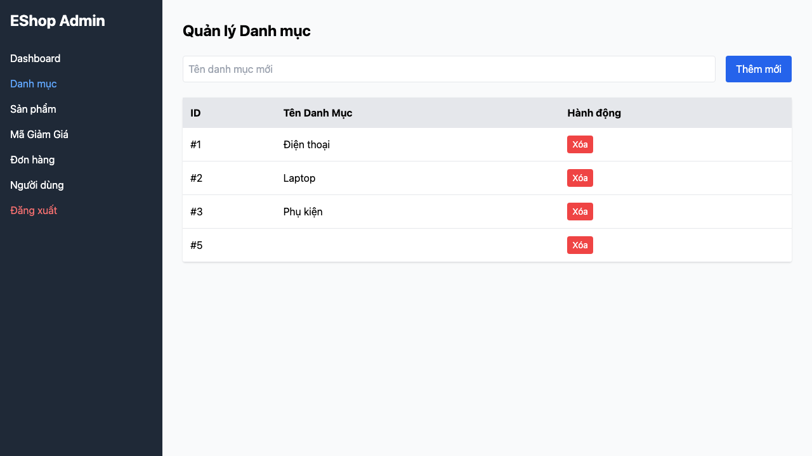

# HW04 – Bug report (20120359 – Nguyễn Đức Quang)

Nguồn: 9 HTML report chạy ngày 2026-11-18 (04:48–04:51 UTC) trong `reports/FR-xx-<browser>/`. Mọi test đỏ dưới đây đỏ giống nhau trên cả Chromium, Firefox, WebKit, đã phân loại là lỗi EShop (không phải lỗi script) ở Bước 6 của từng FR trong `ai/audit-report.md`.

Mỗi mục bên dưới (từ dòng `**Tiêu đề issue**` trở xuống) dán thẳng được làm body issue trên `kqanGit/eshop-sut`. Cột "Issue HW04" điền sau khi tạo issue.

## Tóm tắt

| ID | FR | Tiêu đề | Mức độ | Test đỏ | Browser | Issue HW02 | Issue HW04 |
| --- | --- | --- | --- | --- | --- | --- | --- |
| BUG-HW04-01 | FR-04 | Từ chối SĐT hợp lệ (bắt đầu 0, 10–11 số) | High | D-04-01, D-04-02, D-04-08, B-04-08 | Chromium, Firefox, WebKit | [#2](https://github.com/kqanGit/eshop-sut/issues/2) | [#165](https://github.com/kqanGit/eshop-sut/issues/165) |
| BUG-HW04-02 | FR-04 | Chấp nhận SĐT không bắt đầu bằng 0 | High | D-04-03 | Chromium, Firefox, WebKit | [#3](https://github.com/kqanGit/eshop-sut/issues/3) | [#166](https://github.com/kqanGit/eshop-sut/issues/166) |
| BUG-HW04-03 | FR-04 | User tự nâng `role` lên `admin` qua `PUT /api/users/me` | Critical | D-04-10 | Chromium, Firefox, WebKit | [#5](https://github.com/kqanGit/eshop-sut/issues/5) | [#167](https://github.com/kqanGit/eshop-sut/issues/167) |
| BUG-HW04-04 | FR-09 | Tổng đơn đúng bằng ngưỡng tối thiểu bị từ chối | High | D-09-05, B-09-05 | Chromium, Firefox, WebKit | [#15](https://github.com/kqanGit/eshop-sut/issues/15) | [#168](https://github.com/kqanGit/eshop-sut/issues/168) |
| BUG-HW04-05 | FR-09 | Công thức giảm giá `percent` sai (SAVE10 giảm -36.000.000) | Critical | D-09-01 | Chromium, Firefox, WebKit | [#16](https://github.com/kqanGit/eshop-sut/issues/16) | [#169](https://github.com/kqanGit/eshop-sut/issues/169) |
| BUG-HW04-06 | FR-09 | Áp mã giảm giá không cần đăng nhập | High | D-09-06 | Chromium, Firefox, WebKit | [#17](https://github.com/kqanGit/eshop-sut/issues/17) | [#170](https://github.com/kqanGit/eshop-sut/issues/170) |
| BUG-HW04-07 | FR-14 | Tạo được danh mục tên rỗng / chỉ khoảng trắng | High | D-14-02, D-14-03 | Chromium, Firefox, WebKit | [#46](https://github.com/kqanGit/eshop-sut/issues/46) | [#171](https://github.com/kqanGit/eshop-sut/issues/171) |
| BUG-HW04-08 | FR-14 | User thường tạo được danh mục | Critical | D-14-08 | Chromium, Firefox, WebKit | [#48](https://github.com/kqanGit/eshop-sut/issues/48) | [#172](https://github.com/kqanGit/eshop-sut/issues/172) |
| BUG-HW04-09 | FR-14 | User thường xóa được danh mục | Critical | AT-01 | Chromium, Firefox, WebKit | liên quan [#48](https://github.com/kqanGit/eshop-sut/issues/48) | [#173](https://github.com/kqanGit/eshop-sut/issues/173) |

Ảnh trang GitHub Issues (lọc `label:HW04 label:Quang`, 9 issue #165–#173):

Môi trường chung: macOS, Playwright 1.65.1, Chromium / Firefox / WebKit, EShop chạy local (web `http://localhost:5173`, admin `http://localhost:5174`, API `http://localhost:3000`). Tài khoản: `test@eshop.com` (user), `admin@eshop.com` (admin).

Về ảnh: ảnh lấy từ screenshot lúc fail trong report Chromium (Playwright tự chụp). Bug chỉ có test API (03, 06, 08, 09) thì ảnh lúc fail là trang trắng (test không mở trang), nên không dùng; bằng chứng là thông báo lỗi và annotation `response` trong HTML report.

---

## BUG-HW04-01

**Tiêu đề issue:** `[FR-04] Từ chối số điện thoại hợp lệ (bắt đầu bằng 0, 10–11 chữ số)`

**Nhãn:** `Quang`, `FR-04`, `HW04` · **Mức độ:** High

**Môi trường:** macOS, Playwright 1.65.1, Chromium / Firefox / WebKit, EShop localhost (web :5173, API :3000)

**Bước tái hiện**
1. Đăng nhập web bằng `test@eshop.com`.
2. Bấm "Chào, Test User" để vào trang "Hồ sơ của bạn".
3. Nhập Số điện thoại `0912345678` (10 số) hoặc `09123456789` (11 số).
4. Bấm "Cập nhật".

**Kết quả mong đợi:** Lưu thành công. Đặc tả FR-04: "Số điện thoại hợp lệ: bắt đầu bằng số `0`, từ 10–11 chữ số."

**Kết quả thực tế:** Alert "Số điện thoại không hợp lệ. Vui lòng nhập đúng 9-10 chữ số.", SĐT không được lưu. Vì vậy cũng không cập nhật được địa chỉ (D-04-08) hay Họ Tên 1 ký tự (B-04-08) khi nhập kèm SĐT đúng đặc tả.

**Dẫn chứng code:** `frontend-web/src/pages/Profile.jsx:43` dùng regex `/^[1-9][0-9]{8,9}$/`: cấm số 0 đầu và chỉ nhận 9–10 chữ số.

**Test case / report:** `TC-FR04-D-04-01`, `D-04-02`, `D-04-08`, `B-04-08`, đỏ trên cả 3 browser. Report: `reports/FR-04-chromium/index.html` (cũng `FR-04-firefox`, `FR-04-webkit`), thông báo lỗi `Expected substring: "thành công"`, `Received string: "Số điện thoại không hợp lệ. Vui lòng nhập đúng 9-10 chữ số."`, annotation `alert`.

**Ảnh:** (Playwright chụp sau khi alert đã đóng nên ảnh không có alert; nội dung alert xem ở annotation `alert` trong report)

**Issue HW02:** https://github.com/kqanGit/eshop-sut/issues/2

---

## BUG-HW04-02

**Tiêu đề issue:** `[FR-04] Chấp nhận số điện thoại không bắt đầu bằng 0`

**Nhãn:** `Quang`, `FR-04`, `HW04` · **Mức độ:** High

**Môi trường:** macOS, Playwright 1.65.1, Chromium / Firefox / WebKit, EShop localhost (web :5173, API :3000)

**Bước tái hiện**
1. Đăng nhập web bằng `test@eshop.com`, vào trang "Hồ sơ của bạn".
2. Nhập Số điện thoại `9123456789`.
3. Bấm "Cập nhật".
4. Gọi `GET /api/users/me` để xem SĐT đã lưu.

**Kết quả mong đợi:** Bị từ chối, SĐT không được lưu. Đặc tả FR-04: "Số điện thoại hợp lệ: bắt đầu bằng số `0`, từ 10–11 chữ số."

**Kết quả thực tế:** Alert "Cập nhật thành công!", SĐT `9123456789` được lưu vào database.

**Dẫn chứng code:** `frontend-web/src/pages/Profile.jsx:43` regex `/^[1-9][0-9]{8,9}$/` cho phép số đầu từ 1–9.

**Test case / report:** `TC-FR04-D-04-03`, đỏ trên cả 3 browser. Report: `reports/FR-04-chromium/index.html`, thông báo lỗi `Expected substring: "không hợp lệ"`, `Received string: "Cập nhật thành công!"`, annotation `alert`.

**Ảnh:** (ảnh không có alert vì Playwright chụp sau khi dialog đóng)

**Issue HW02:** https://github.com/kqanGit/eshop-sut/issues/3

---

## BUG-HW04-03

**Tiêu đề issue:** `[FR-04] User tự nâng role lên admin qua PUT /api/users/me`

**Nhãn:** `Quang`, `FR-04`, `HW04` · **Mức độ:** Critical

**Môi trường:** macOS, Playwright 1.65.1 (API request, chạy trong cả 3 project Chromium / Firefox / WebKit), EShop API localhost:3000

**Bước tái hiện**
1. `POST /api/login` bằng `test@eshop.com` để lấy token.
2. `PUT /api/users/me` với header `Authorization: Bearer <token>`, body `{"name": "Test User", "role": "admin"}`.
3. `GET /api/users/me` xem `role`.

**Kết quả mong đợi:** `role` vẫn là `user`. Đặc tả FR-04: "Người dùng chỉ có thể cập nhật hồ sơ của chính mình; không thể tự thay đổi thuộc tính `role`." (SEC-06: "API cập nhật hồ sơ không được cho phép thay đổi trường `role` từ client.")

**Kết quả thực tế:** `role` trong database thành `admin`.

**Dẫn chứng code:** `backend/server.js:119-127` lấy `role` từ `req.body` và thêm `role = ?` vào câu `UPDATE` nếu có.

**Test case / report:** `TC-FR04-D-04-10`, đỏ trên cả 3 browser. Report: `reports/FR-04-chromium/index.html`, thông báo lỗi `Expected: "user"`, `Received: "admin"` (`tests/FR-04.spec.js:28`).

**Ảnh:** Không có. Test chỉ gọi API nên ảnh lúc fail là trang trắng; bằng chứng là thông báo lỗi trong report.

**Issue HW02:** https://github.com/kqanGit/eshop-sut/issues/5

---

## BUG-HW04-04

**Tiêu đề issue:** `[FR-09] Tổng đơn đúng bằng ngưỡng tối thiểu bị từ chối (dùng > thay vì >=)`

**Nhãn:** `Quang`, `FR-09`, `HW04` · **Mức độ:** High

**Môi trường:** macOS, Playwright 1.65.1, Chromium / Firefox / WebKit, EShop localhost (web :5173, API :3000)

**Bước tái hiện**
1. Đăng nhập web bằng `test@eshop.com`, thêm 1 sản phẩm vào giỏ, vào trang "Xác Nhận Đơn Hàng".
2. Sửa ô "Tổng tiền thanh toán (VND)" thành `300000`.
3. Nhập mã `SAVE10` (ngưỡng 300,000 ₫), bấm "Áp dụng".
4. Lặp lại với tổng `500000` và mã `BIGBUY` (ngưỡng 500,000 ₫).

**Kết quả mong đợi:** Áp mã thành công (SAVE10: giảm 30.000, còn 270.000; BIGBUY: giảm 50.000, còn 450.000). Đặc tả FR-09, C3: "Tổng đơn hàng **>= (lớn hơn hoặc bằng)** `min_order_amount`".

**Kết quả thực tế:** Báo "Đơn hàng chưa đủ giá trị tối thiểu 300,000 ₫ để áp dụng mã này" (BIGBUY: "... 500,000 ₫ ..."), không có dòng "Tiết kiệm".

**Dẫn chứng code:** `backend/server.js:379` `if (total_amount > coupon.min_order_amount)`.

**Test case / report:** `TC-FR09-D-09-05`, `B-09-05`, đỏ trên cả 3 browser. Report: `reports/FR-09-chromium/index.html`, thông báo lỗi `expect(locator).toBeVisible() failed` ở khối "Tiết kiệm:", annotation `result`: `lỗi: Đơn hàng chưa đủ giá trị tối thiểu 300,000 ₫ để áp dụng mã này`.

**Ảnh:**

**Issue HW02:** https://github.com/kqanGit/eshop-sut/issues/15

---

## BUG-HW04-05

**Tiêu đề issue:** `[FR-09] Công thức giảm giá percent sai, SAVE10 giảm -36.000.000 ₫`

**Nhãn:** `Quang`, `FR-09`, `HW04` · **Mức độ:** Critical

**Môi trường:** macOS, Playwright 1.65.1, Chromium / Firefox / WebKit, EShop localhost (web :5173, API :3000)

**Bước tái hiện**
1. Đăng nhập web bằng `test@eshop.com`, thêm "Bàn phím cơ Keychron Q1" (4.000.000 ₫) vào giỏ, vào trang "Xác Nhận Đơn Hàng".
2. Nhập mã `SAVE10`, bấm "Áp dụng".

**Kết quả mong đợi:** Tiết kiệm 400.000 ₫, Thành tiền 3.600.000 ₫. Đặc tả FR-09: "Loại `percent`: `discount_amount = total × discount_value / 100`", "`final_amount = total - discount_amount`".

**Kết quả thực tế:** "Áp dụng thành công! Giảm 10%", nhưng "Tiết kiệm: -36.000.000 ₫", "Thành tiền: 40.000.000 ₫" (đơn tăng gấp 10).

**Dẫn chứng code:** `backend/server.js:399-401` (và `419-421`) tính `Math.floor(total_amount * (1 - coupon.discount_value))` với `discount_value = 10`.

**Test case / report:** `TC-FR09-D-09-01`, đỏ trên cả 3 browser. Report: `reports/FR-09-chromium/index.html`, thông báo lỗi `Expected: 400000`, `Received: -36000000`, annotation `result`: `tiết kiệm -36.000.000 ₫, thành tiền 40.000.000 ₫`.

**Ảnh:**

**Issue HW02:** https://github.com/kqanGit/eshop-sut/issues/16

---

## BUG-HW04-06

**Tiêu đề issue:** `[FR-09] Áp mã giảm giá không cần đăng nhập (thiếu điều kiện C4)`

**Nhãn:** `Quang`, `FR-09`, `HW04` · **Mức độ:** High

**Môi trường:** macOS, Playwright 1.65.1 (API request, chạy trong cả 3 project Chromium / Firefox / WebKit), EShop API localhost:3000

**Bước tái hiện**
1. Gọi `POST /api/apply-coupon` **không** có header `Authorization`, body `{"code": "SAVE10", "total_amount": 300001, "user_id": null}`.

**Kết quả mong đợi:** Bị từ chối (không `success`). Đặc tả FR-09, C4: "Người dùng phải có JWT Token hợp lệ".

**Kết quả thực tế:** `200 {"success":true,"coupon_id":1,"discount_amount":-2700009,"final_amount":3000010,"message":"Áp dụng thành công! Giảm 10%"}` (số tiền sai là do BUG-HW04-05).

**Dẫn chứng code:** `backend/server.js:363` route `app.post("/api/apply-coupon", (req, res) => ...)` không có `authenticateToken`; nhánh `user_id` rỗng (`416-432`) vẫn trả `success`.

**Test case / report:** `TC-FR09-D-09-06`, đỏ trên cả 3 browser. Report: `reports/FR-09-chromium/index.html`, thông báo lỗi `expect(received).not.toBe(expected)`, `Expected: not true` (`tests/FR-09.spec.js:54`), annotation `response` ghi response ở trên.

**Ảnh:** Không có. Test chỉ gọi API nên ảnh lúc fail là trang trắng; bằng chứng là annotation `response` trong report.

**Issue HW02:** https://github.com/kqanGit/eshop-sut/issues/17

---

## BUG-HW04-07

**Tiêu đề issue:** `[FR-14] Tạo được danh mục tên rỗng hoặc chỉ có khoảng trắng`

**Nhãn:** `Quang`, `FR-14`, `HW04` · **Mức độ:** High

**Môi trường:** macOS, Playwright 1.65.1, Chromium / Firefox / WebKit, EShop localhost (admin :5174, API :3000)

**Bước tái hiện**
1. Đăng nhập trang admin bằng `admin@eshop.com`, vào menu "Danh mục".
2. Để trống ô "Tên danh mục mới" (hoặc nhập `"   "` 3 khoảng trắng).
3. Bấm "Thêm mới".
4. Gọi `GET /api/categories` xem danh sách.

**Kết quả mong đợi:** Bị từ chối, không có danh mục mới. Đặc tả FR-14: "Tên danh mục là bắt buộc, không được để trống."

**Kết quả thực tế:** Không có thông báo lỗi; danh mục mới được tạo, ví dụ `{"id": 5, "name": ""}` và `{"id": 6, "name": "   "}`, bảng có thêm dòng không tên.

**Dẫn chứng code:** `frontend-admin/src/App.jsx:298-304` ô tên không có `required`, `142-147` gửi thẳng `categoryName`; `backend/server.js:249-251` không kiểm tra `name` (không `trim`) trước khi `INSERT`.

**Test case / report:** `TC-FR14-D-14-02`, `D-14-03`, đỏ trên cả 3 browser. Report: `reports/FR-14-chromium/index.html`, thông báo lỗi `expect(received).toEqual(expected)`: mong đợi `[]`, nhận `[{"id": 5, "name": ""}]` (`tests/FR-14.spec.js:92`).

**Ảnh:** (dòng `#5` không có tên trong bảng)

**Issue HW02:** https://github.com/kqanGit/eshop-sut/issues/46

---

## BUG-HW04-08

**Tiêu đề issue:** `[FR-14] User thường tạo được danh mục qua POST /api/categories`

**Nhãn:** `Quang`, `FR-14`, `HW04` · **Mức độ:** Critical

**Môi trường:** macOS, Playwright 1.65.1 (API request, chạy trong cả 3 project Chromium / Firefox / WebKit), EShop API localhost:3000

**Bước tái hiện**
1. `POST /api/login` bằng `test@eshop.com` (role `user`) để lấy token.
2. `POST /api/categories` với header `Authorization: Bearer <token>`, body `{"name": "HW04-UserShouldNotCreate"}`.

**Kết quả mong đợi:** Bị từ chối, danh mục không được tạo. Đặc tả FR-12: các API ảnh hưởng dữ liệu (`POST/PUT/DELETE ... /api/categories`) phải yêu cầu "Token JWT hợp lệ" và "`role = 'admin'` trong Token"; FR-14: "Admin có thể Thêm / Xem / Xóa danh mục."

**Kết quả thực tế:** `200 {"message":"Category created","id":10}`, danh mục được tạo.

**Dẫn chứng code:** `backend/server.js:249` route chỉ có `authenticateToken`; middleware ở `100-110` chỉ verify JWT, không kiểm `role`.

**Test case / report:** `TC-FR14-D-14-08`, đỏ trên cả 3 browser. Report: `reports/FR-14-chromium/index.html`, thông báo lỗi `Expected: false`, `Received: true` cho `res.ok()` (`tests/FR-14.spec.js:57`), annotation `response`.

**Ảnh:** Không có. Test chỉ gọi API nên ảnh lúc fail là trang trắng; bằng chứng là annotation `response` trong report.

**Issue HW02:** https://github.com/kqanGit/eshop-sut/issues/48

---

## BUG-HW04-09

**Tiêu đề issue:** `[FR-14] User thường xóa được danh mục qua DELETE /api/categories/:id`

**Nhãn:** `Quang`, `FR-14`, `HW04` · **Mức độ:** Critical

**Môi trường:** macOS, Playwright 1.65.1 (API request, chạy trong cả 3 project Chromium / Firefox / WebKit), EShop API localhost:3000

**Bước tái hiện**
1. Admin tạo danh mục `HW04-UserShouldNotDelete` (`POST /api/categories` bằng token admin), ghi lại `id`.
2. `POST /api/login` bằng `test@eshop.com` (role `user`) để lấy token.
3. `DELETE /api/categories/<id>` với header `Authorization: Bearer <token user>`.
4. `GET /api/categories` xem danh mục còn không.

**Kết quả mong đợi:** Bị từ chối, danh mục vẫn còn. Đặc tả FR-12: `DELETE /api/categories` phải yêu cầu "Token JWT hợp lệ" và "`role = 'admin'` trong Token"; FR-14: "Admin có thể Thêm / Xem / Xóa danh mục."

**Kết quả thực tế:** `200 {"message":"Category deleted"}`, danh mục bị xóa.

**Dẫn chứng code:** `backend/server.js:269` route `DELETE /api/categories/:id` cũng chỉ có `authenticateToken`, không kiểm `role`.

**Test case / report:** `TC-FR14-AT-01`, đỏ trên cả 3 browser. Report: `reports/FR-14-chromium/index.html`, thông báo lỗi `Expected: false`, `Received: true` cho `res.ok()` (`tests/FR-14.spec.js:57`), annotation `response`.

**Ảnh:** Không có. Test chỉ gọi API nên ảnh lúc fail là trang trắng; bằng chứng là annotation `response` trong report.

**Issue HW02:** Bug mới ở HW04, cùng nguyên nhân với https://github.com/kqanGit/eshop-sut/issues/48 (thiếu kiểm `role`), khác thao tác (xóa thay vì tạo).
