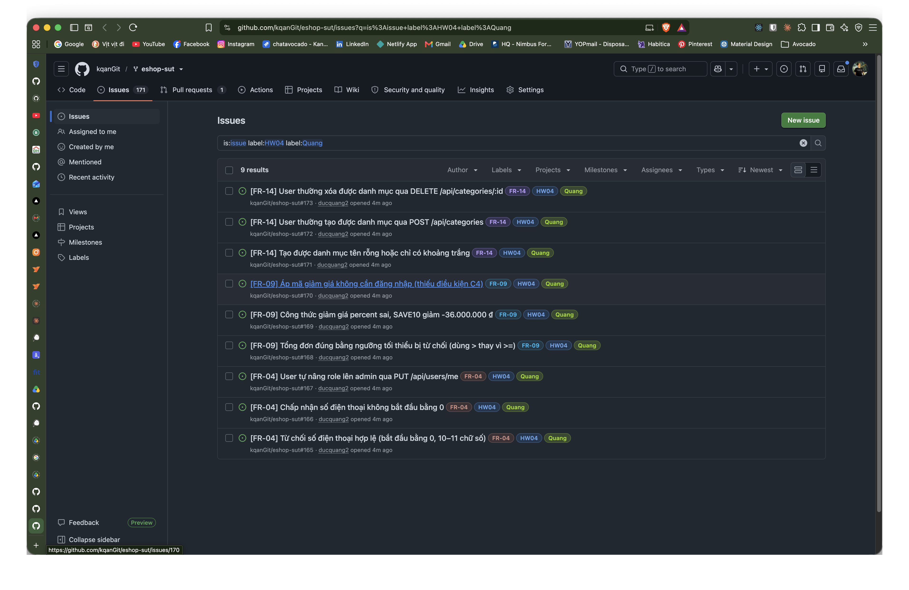

# HW04 – Automation Testing với Playwright (AI-first)

## 1. Thông tin chung

| Mục | Nội dung |
| --- | --- |
| MSSV | 20120359 |
| Họ tên | Nguyễn Đức Quang |
| Repo | https://github.com/ducquang2/HW04-Automation |
| SUT | EShop (fork `kqanGit/eshop-sut`), chạy local: web `:5173`, admin `:5174`, API `:3000` |
| Công cụ | Playwright 1.65.1 (JavaScript), pnpm, HTML reporter |
| AI | Claude Code (Claude Opus 5.5) trong VS Code; FR-09, FR-14 dùng subagent + Agent Skill |
| Feature | FR-04 Hồ sơ cá nhân, FR-09 Mã giảm giá, FR-14 CRUD danh mục (Admin) |

## 2. Thiết lập

### 2.1 Cấu trúc repo

| Đường dẫn | Nội dung |
| --- | --- |
| `playwright.config.js` | Cấu hình chung, 3 project browser |
| `run-all.js` | Chạy 9 lượt (3 feature x 3 browser), ra 9 report |
| `helpers/common.js` | Helper dùng chung (đăng nhập, gọi API, dọn dữ liệu) |
| `data/FR-04.json`, `FR-09.json`, `FR-14.json` | Dữ liệu test, mỗi file 12 dòng |
| `tests/FR-04.spec.js`, `FR-09.spec.js`, `FR-14.spec.js` | Script data-driven (đọc JSON, mỗi dòng một test) |
| `reports/FR-xx-<browser>/` | 9 HTML report chính thức |
| `report/bugs.md`, `report/bug-screenshots/`, `report/github-issues.png` | Bug report và ảnh |
| `skills/eshop-playwright-feature/SKILL.md` | Agent Skill |
| `ai/audit-report.md` | Nhật ký dùng AI |

### 2.2 Cấu hình `playwright.config.js`

| Thiết lập | Giá trị | Lý do |
| --- | --- | --- |
| `workers` | `1` (`fullyParallel: false`) | Các test dùng chung 1 backend, chạy song song sẽ đụng dữ liệu |
| `retries` | `0` | Không retry để không che bug |
| `timeout` | 30 giây | Mặc định |
| `baseURL` | `http://localhost:5173` | Web người dùng |
| `locale` | `vi-VN` | Số tiền in giống nhau trên cả 3 browser |
| `screenshot` / `trace` | `only-on-failure` / `retain-on-failure` | Có bằng chứng khi test đỏ |
| `projects` | `chromium`, `firefox`, `webkit` | 3 browser |
| HTML reporter | `outputFolder: reports/${FEATURE}-${BROWSER}`, `title: Run by: 20120359 \| <FR> \| <browser> \| <ISO timestamp>` | Mỗi lượt một report, có MSSV và timestamp |

`FEATURE`, `BROWSER` lấy từ biến môi trường. `helpers/common.js` có hàm `runBy` thêm annotation `Run by: 20120359 @ <ISO>` vào từng test.

### 2.3 `run-all.js`

Lặp 3 feature x 3 browser, mỗi lượt gọi `pnpm exec playwright test tests/<FR>.spec.js --project=<browser>` với `FEATURE`, `BROWSER` tương ứng, ra 9 thư mục report. Chạy bằng `pnpm run-all`.

### 2.4 Helper chung và dọn dữ liệu bằng API

| Helper | Dùng cho | Việc làm |
| --- | --- | --- |
| `loginWeb`, `apiToken`, `getMe` | Chung, FR-04 | Đăng nhập web; lấy token qua `POST /api/login`; đọc hồ sơ qua `GET /api/users/me` |
| `resetProfile` | FR-04 | `PUT /api/users/me` trả hồ sơ `test@eshop.com` về seed (gửi đủ mọi cột, kể cả `role: "user"`) |
| `goToCheckout` | FR-09 | Logo → Thêm Keychron Q1 vào giỏ → Giỏ hàng → Tiến hành thanh toán (giỏ chỉ nằm trong React state) |
| `createTempUser`, `cleanupUsers` | FR-09 | Tạo user tạm qua `POST /api/register`; xóa mọi user id > 2 bằng token admin |
| `loginAdmin`, `openAdminTab` | FR-14 | Đăng nhập admin `:5174`; mở tab theo chữ menu |
| `cleanupCategories` | FR-14 | Xóa mọi danh mục id > 3 bằng token admin, `DELETE` lỗi thì fail luôn |

Mỗi spec gọi hàm dọn ở cả `beforeEach` và `afterEach`, nên lượt browser sau luôn bắt đầu từ dữ liệu seed (hồ sơ seed, chỉ còn user id 1–2, chỉ còn 3 danh mục seed).

## 3. Quy trình AI-first

Mỗi feature đi qua 7 bước, mỗi bước 1 prompt do sinh viên viết; sau mỗi bước có điểm dừng để sinh viên duyệt rồi mới sang bước sau:

| Bước | Việc AI làm | Sinh viên duyệt |
| --- | --- | --- |
| 1. Chọn test case | Đọc đặc tả + test case HW02, đề xuất 12 case, lý do loại case còn lại, tầng UI/API, dự đoán Pass/Fail | Chốt 12 case, tầng chạy |
| 2. Locator | Đọc `.jsx`, đề xuất locator, chạy thử trên app, báo số phần tử khớp | Duyệt bảng locator |
| 3. File dữ liệu | Thiết kế `data/FR-xx.json`, `expected` theo đặc tả | Rà từng `expected` với đặc tả |
| 4. Khung script | Spec đọc JSON, dọn dữ liệu bằng API, chạy thử Chromium | Script chạy hết, dữ liệu về seed |
| 5. Assertion | Assertion cho từng loại `expected`, ít nhất 3 kiểu, không `waitForTimeout` | Duyệt bảng assertion, danh sách test đỏ |
| 6. Chạy 3 browser | Chạy 3 browser, phân loại test đỏ: lỗi script hay lỗi EShop | Duyệt bảng phân loại, danh sách bug |
| 7. Review | Đọc lại spec + data, sửa lỗi, lập bảng "AI sai gì / vì sao / sửa thế nào" | Duyệt bảng review |

- FR-04 làm trực tiếp với Claude Code. Sau FR-04, 7 bước được viết lại thành Agent Skill (mục 10).
- FR-09 và FR-14 làm bằng Claude Code subagent dùng skill `eshop-playwright-feature`. Quyết định của sinh viên sau mỗi bước được ghi trong audit (dòng "Quyết định của sinh viên sau Bước n").
- Mọi lần dùng AI (thời gian, prompt nguyên văn, ngữ cảnh, output) ghi trong `ai/audit-report.md`.

## 4. Kết quả từng feature

### 4.1 FR-04 Hồ sơ cá nhân

**Đặc tả tóm tắt:** Người dùng xem và cập nhật hồ sơ của chính mình (Họ Tên, Số điện thoại, Địa chỉ). SĐT hợp lệ: bắt đầu bằng `0`, 10–11 chữ số. Email không sửa được. Không được tự đổi `role` (SEC-06).

**12 test case** (HW02 có 18 case: 10 Domain + 8 BVA)

| # | ID | Nội dung | Dữ liệu chính | Expected theo đặc tả | Tầng |
| --- | --- | --- | --- | --- | --- |
| 1 | D-04-01 | SĐT 10 số bắt đầu 0 | `0912345678` | Cập nhật thành công | UI |
| 2 | D-04-02 | SĐT 11 số bắt đầu 0 | `09123456789` | Cập nhật thành công | UI |
| 3 | D-04-03 | SĐT không bắt đầu bằng 0 | `9123456789` | Báo không hợp lệ, không lưu | UI |
| 4 | D-04-04 | SĐT 9 số | `091234567` | Báo không hợp lệ | UI |
| 5 | D-04-05 | SĐT 12 số | `091234567890` | Báo không hợp lệ | UI |
| 6 | D-04-06 | SĐT có chữ | `09ab345678` | Báo không hợp lệ | UI |
| 7 | D-04-07 | Họ Tên rỗng | `""` + SĐT `0912345678` | Form không gửi, ô báo thiếu | UI |
| 8 | D-04-08 | Cập nhật địa chỉ | `123 Nguyen Trai` + SĐT `0912345678` | Lưu, tải lại trang vẫn còn | UI |
| 9 | D-04-09 | Ô Email bị khóa | – | Ô disabled, giá trị `test@eshop.com` | UI |
| 10 | D-04-10 | Gửi `role: "admin"` | `PUT /api/users/me` | `role` vẫn là `user` | API |
| 11 | B-04-06 | SĐT rỗng | `""` | Báo không hợp lệ | UI |
| 12 | B-04-08 | Họ Tên 1 ký tự | `A` + SĐT `0912345678` | Cập nhật thành công | UI |

**Case bị loại:** 6 case BVA trùng dữ liệu với Domain: B-04-01 = D-04-04, B-04-02 = D-04-01, B-04-03 = D-04-02, B-04-04 = D-04-05, B-04-05 = D-04-03, B-04-07 = D-04-07.

**Quyết định quan trọng:**
- D-04-04/05/06 chạy qua UI (HW02 chạy qua API). Regex frontend chặn trước nên 3 case này xanh, không lộ lỗi backend (xem gap analysis).
- D-04-10 chạy API vì giao diện không có ô `role`.
- D-04-07, D-04-08, B-04-08 phải điền kèm SĐT đúng đặc tả vì SĐT ban đầu trống mà form bắt buộc SĐT hợp lệ. Hệ quả: D-04-08, B-04-08 đỏ do lỗi SĐT, không phải do địa chỉ hay họ tên.
- Không assert nguyên văn câu thông báo (đặc tả không quy định câu chữ); assertion chính là dữ liệu đã lưu qua `GET /api/users/me`. Câu chữ alert dùng `expect.soft`.

**Kiểu assertion**

| expected | Assertion | Kiểu |
| --- | --- | --- |
| `success` | Alert chứa "thành công" (soft); từng trường đã lưu đúng trong database; D-04-08 tải lại trang rồi `toHaveValue` | Dialog, dữ liệu qua API, giá trị ô |
| `invalid-phone` | Alert chứa "không hợp lệ" (soft); `phone` trong database vẫn `null` | Dialog, dữ liệu qua API |
| `missing-name` | `validity.valueMissing` = `true`; URL vẫn `/profile`; không có alert; tên trong database không đổi | Trạng thái validity, URL, dữ liệu qua API |
| `email-locked` | `toBeDisabled()`, `toHaveValue('test@eshop.com')` | Thuộc tính, giá trị ô |
| `role-unchanged` | `role` trong database vẫn `user` | Dữ liệu qua API |

Tổng 6 kiểu: dialog, dữ liệu qua API, giá trị ô, thuộc tính, URL, trạng thái validity.

**Kết quả 3 browser**

| Browser | Pass | Fail |
| --- | --- | --- |
| Chromium | 6 | 6 |
| Firefox | 6 | 6 |
| WebKit | 6 | 6 |

| Case đỏ (cả 3 browser) | Thực tế | Bug HW04 | Issue HW02 |
| --- | --- | --- | --- |
| D-04-01, D-04-02, D-04-08, B-04-08 | Alert "Số điện thoại không hợp lệ. Vui lòng nhập đúng 9-10 chữ số." với SĐT đúng đặc tả (`Profile.jsx:43` regex `/^[1-9][0-9]{8,9}$/`) | BUG-HW04-01 ([#165](https://github.com/kqanGit/eshop-sut/issues/165)) | [#2](https://github.com/kqanGit/eshop-sut/issues/2) |
| D-04-03 | Alert "Cập nhật thành công!", lưu `9123456789` | BUG-HW04-02 ([#166](https://github.com/kqanGit/eshop-sut/issues/166)) | [#3](https://github.com/kqanGit/eshop-sut/issues/3) |
| D-04-10 | `role` trong database thành `admin` (`server.js:119-127`) | BUG-HW04-03 ([#167](https://github.com/kqanGit/eshop-sut/issues/167)) | [#5](https://github.com/kqanGit/eshop-sut/issues/5) |

Không có case nào chỉ đỏ trên một browser. Cả 18 lượt đỏ là lỗi EShop, không phải lỗi script.

### 4.2 FR-09 Mã giảm giá

**Đặc tả tóm tắt:** Áp mã ở trang checkout. Mã hợp lệ khi thỏa C1 tồn tại và đang hoạt động, C2 còn hạn, C3 tổng đơn `>=` `min_order_amount`, C4 có JWT hợp lệ, C5 còn lượt dùng cho người đó. `percent`: `discount = total × value / 100`; `fixed`: `discount = value`; `final = total - discount`.

**12 test case** (HW02 có 17 case: 11 Domain + 6 BVA)

| # | ID | Nội dung | Mã / Tổng | Expected theo đặc tả | Tầng |
| --- | --- | --- | --- | --- | --- |
| 1 | D-09-01 | Happy path percent | SAVE10 / 4.000.000 (giỏ thật) | Giảm 400.000, còn 3.600.000 | UI |
| 2 | D-09-02 | C1 mã không tồn tại | FAKEMAC / 4.000.000 | Báo lỗi, không giảm | UI |
| 3 | D-09-03 | C2 mã hết hạn | EXPIRED / 4.000.000 | Báo lỗi, không giảm | UI |
| 4 | D-09-04 | C3 dưới ngưỡng | SAVE10 / 299.999 (sửa ô) | Báo lỗi | UI |
| 5 | D-09-05 | C3 đúng ngưỡng | SAVE10 / 300.000 (sửa ô) | Giảm 30.000, còn 270.000 | UI |
| 6 | D-09-06 | C4 không JWT | SAVE10 / 300.001, `user_id: null` | Bị từ chối | API |
| 7 | D-09-07 | C5 SAVE10 đã dùng 1/1 | SAVE10 / 4.000.000, user tạm | Báo hết lượt | API |
| 8 | D-09-08 | C5 VIP100 đã dùng 1/2 | VIP100 / 4.000.000, user tạm | Giảm 100.000, còn 3.900.000 | API |
| 9 | D-09-09 | C5 VIP100 đã dùng 2/2 | VIP100 / 4.000.000, user tạm | Báo hết lượt | API |
| 10 | D-09-11 | Công thức fixed | VIP100 / 4.000.000 (giỏ thật) | Giảm 100.000, còn 3.900.000 | UI |
| 11 | B-09-04 | BIGBUY dưới ngưỡng | BIGBUY / 499.999 (sửa ô) | Báo lỗi | UI |
| 12 | B-09-05 | BIGBUY đúng ngưỡng | BIGBUY / 500.000 (sửa ô) | Giảm 50.000, còn 450.000 | UI |

**Case bị loại** (trùng dữ liệu):
- D-09-10 (SAVE10, 300.001, kiểm công thức percent) = D-09-01: cùng mã, cùng mục tiêu; D-09-01 đã assert số tiền.
- B-09-01 (299.999) = D-09-04; B-09-02 (300.000) = D-09-05; B-09-03 (300.001) = D-09-01 / D-09-10.
- B-09-06 (VIP100 lượt 0→1→2→3) = D-09-08 + D-09-09.

**Quyết định quan trọng:**
- Case 4, 5, 11, 12 chạy UI và sửa ô "Tổng tiền thanh toán". Sản phẩm rẻ nhất 4.000.000 ₫, lớn hơn mọi ngưỡng, nên chỉ tạo được tổng biên bằng cách sửa ô này. Ô sửa được là lỗi của FR-08.
- Case 1, 3, 10 đổi tổng so với HW02 sang tổng thật 4.000.000 để không phụ thuộc lỗi FR-08.
- Case 7–9 (C5): mỗi test tạo user tạm, ghi lượt qua `POST /api/coupon-usage`, `afterEach` xóa user bằng token admin. Case UI chỉ bấm "Áp dụng", không bấm "Xác Nhận Thanh Toán" để không tiêu lượt của `test@eshop.com`.
- D-09-06 chỉ assert "không success", không assert số tiền để không lẫn với lỗi công thức percent.
- Case `error` qua API chỉ assert response không `success`, không kiểm mã HTTP. Thêm trường `reason` (C1–C5) cho case `error` để report dễ đọc.
- Giữ cả D-09-08 và D-09-11 (cùng VIP100 trên 4.000.000 nhưng khác mục tiêu: C5 qua API và công thức fixed qua UI).

**Kiểu assertion**

| expected / tầng | Assertion | Kiểu |
| --- | --- | --- |
| Mọi case UI | Nút "Áp dụng" `toBeEnabled()` (soft); case có `total` thì ô Tổng tiền `toHaveValue(total)` (soft) | Trạng thái phần tử, giá trị ô |
| `applied` / UI | Dòng "Tiết kiệm:" hiển thị; số "Tiết kiệm" = `discount`, số "Thành tiền" = `final`; không có dòng lỗi | Hiển thị, nội dung |
| `error` / UI | Dòng lỗi `p.text-red-600` hiển thị; không có "Tiết kiệm:"; câu lỗi theo `reason` (soft) | Hiển thị, nội dung |
| `applied` / API | `success` = `true`, `discount_amount`, `final_amount` đúng | Dữ liệu qua API |
| `error` / API | `success` khác `true`; C5 kiểm câu lỗi (soft); ghi lượt dùng trước phải ok | Dữ liệu qua API |

Tổng 5 kiểu: hiển thị, nội dung, giá trị ô, trạng thái phần tử, dữ liệu qua API.

**Kết quả 3 browser**

| Browser | Pass | Fail |
| --- | --- | --- |
| Chromium | 8 | 4 |
| Firefox | 8 | 4 |
| WebKit | 8 | 4 |

| Case đỏ (cả 3 browser) | Thực tế | Bug HW04 | Issue HW02 |
| --- | --- | --- | --- |
| D-09-05, B-09-05 | Tổng đúng ngưỡng vẫn báo "chưa đủ giá trị tối thiểu" (`server.js:379` dùng `>`) | BUG-HW04-04 ([#168](https://github.com/kqanGit/eshop-sut/issues/168)) | [#15](https://github.com/kqanGit/eshop-sut/issues/15) |
| D-09-01 | "Tiết kiệm -36.000.000 ₫", "Thành tiền 40.000.000 ₫" (`server.js:399-401` tính `total × (1 - 10)`) | BUG-HW04-05 ([#169](https://github.com/kqanGit/eshop-sut/issues/169)) | [#16](https://github.com/kqanGit/eshop-sut/issues/16) |
| D-09-06 | Không JWT vẫn 200 `success: true` (`server.js:363` không có `authenticateToken`) | BUG-HW04-06 ([#170](https://github.com/kqanGit/eshop-sut/issues/170)) | [#17](https://github.com/kqanGit/eshop-sut/issues/17) |

Không có case nào chỉ đỏ trên một browser. Cả 12 lượt đỏ là lỗi EShop.

### 4.3 FR-14 CRUD danh mục (Admin)

**Đặc tả tóm tắt:** Admin Thêm / Xem / Xóa danh mục. Tên danh mục bắt buộc, không được để trống. Theo FR-12, các API `POST/PUT/DELETE /api/categories` phải có JWT hợp lệ và `role = admin`.

**12 test case** (HW02 có 15 case: 10 Domain + 5 BVA; dùng 8 case HW02 và thêm 4 case `AT-xx`)

| # | ID | Nội dung | Dữ liệu chính | Expected theo đặc tả | Tầng |
| --- | --- | --- | --- | --- | --- |
| 1 | D-14-01 | Thêm tên hợp lệ | `HW04-Phu kien Test FR14` | Có dòng mới trong bảng và trong API | UI |
| 2 | D-14-02 | Tên rỗng | `""` | Bị từ chối, không có danh mục mới | UI |
| 3 | D-14-03 | Tên chỉ khoảng trắng | `"   "` | Bị từ chối (coi như rỗng) | UI |
| 4 | D-14-04 | Tên 1 ký tự | `A` | Thêm được | UI |
| 5 | AT-03 | Thêm rồi tải lại trang | `HW04-Reload Test` | Danh mục vẫn còn | UI |
| 6 | D-14-06 | Chuỗi script | `HW04-` | Hiện dạng chữ, không bật dialog | UI |
| 7 | D-14-07 | Thêm không có token | `HW04-UnauthTest` | API từ chối, không tạo | API |
| 8 | D-14-08 | User thường thêm | token `test@eshop.com` | API từ chối, không tạo | API |
| 9 | AT-01 | User thường xóa | admin tạo trước, user xóa | API từ chối, danh mục còn | API |
| 10 | AT-02 | Admin xóa qua UI | admin tạo trước, bấm "Xóa" | Dòng biến mất, API không còn id | UI |
| 11 | D-14-09 | Xem danh sách | 3 danh mục seed | Bảng có đủ Điện thoại, Laptop, Phụ kiện, khớp API | UI |
| 12 | AT-04 | Danh mục mới ở tab Sản phẩm | `HW04-Select Test` | Có option trong `select` danh mục | UI |

Case thêm mới: AT-01 (FR-12 yêu cầu `DELETE` cũng phải là admin, HW02 chỉ thử `POST`), AT-02 (HW02 không có case xóa thành công), AT-03 và AT-04 (thay cho D-14-05, D-14-10).

**Case bị loại / thay:**
- B-14 rỗng = D-14-02; B-14 khoảng trắng = D-14-03; B-14 1 ký tự = D-14-04 (trùng dữ liệu).
- B-14 dài 255 và 256 ký tự: đặc tả không có độ dài tối đa, HW02 chỉ ghi "không crash", không có expected theo đặc tả để assert.
- D-14-05 (trùng tên) và D-14-10 (xóa danh mục còn sản phẩm): đặc tả FR-14 không quy định, thay bằng AT-03, AT-04 (xem mục 8).

**Quyết định quan trọng:**
- Case 7–9 chạy API (admin UI chặn user thường ngay lúc login, chỉ chặn ở frontend). Chỉ assert `res.ok()` = `false` và dữ liệu không đổi, không kiểm 401/403 vì FR-12 không nói mã HTTP.
- Tên toàn khoảng trắng coi như "để trống" (như HW02).
- Chỉ tạo/xóa danh mục id > 3, không đụng 3 danh mục seed; không tạo sản phẩm test.
- AT-04 chỉ kiểm option trong `select`, không bấm "Lưu sản phẩm".
- AT-01 mở issue riêng ở HW04, dẫn link #48 (cùng nguyên nhân, khác thao tác).

**Kiểu assertion**

| expected | Assertion | Kiểu |
| --- | --- | --- |
| `created` | Ô tên `toHaveValue('')` (soft); dòng theo tên `toBeVisible()`; API có tên đó. D-14-06: dialog = `null`, ô tên `toHaveText` đúng chuỗi `<script>` | Giá trị ô, hiển thị, dữ liệu qua API, dialog, nội dung |
| `rejected-empty` | API không có danh mục id > 3; `tbody tr` `toHaveCount(3)` | Dữ liệu qua API, số lượng |
| `persisted` | Sau reload và bấm lại menu, dòng theo tên `toBeVisible()`; API có tên đó | Hiển thị, dữ liệu qua API |
| `in-product-select` | Option đúng tên trong `combobox` `toHaveCount(1)` | Số lượng |
| `deleted` | Dòng theo tên `toHaveCount(0)`; API không còn id | Số lượng, dữ liệu qua API |
| `listed` | Bảng `toHaveCount(3)` và từng tên `toBeVisible()`; tên từ API sort rồi `toEqual` | Số lượng, hiển thị, dữ liệu qua API |
| `rejected-auth` | `res.ok()` = `false`; `POST` thì API không có tên đó, `DELETE` thì API vẫn còn id; case `token: user` kiểm token lấy được | Dữ liệu qua API |

Tổng 6 kiểu: hiển thị, nội dung, số lượng, giá trị ô, dialog, dữ liệu qua API.

**Kết quả 3 browser**

| Browser | Pass | Fail |
| --- | --- | --- |
| Chromium | 8 | 4 |
| Firefox | 8 | 4 |
| WebKit | 8 | 4 |

| Case đỏ (cả 3 browser) | Thực tế | Bug HW04 | Issue HW02 |
| --- | --- | --- | --- |
| D-14-02, D-14-03 | Tên `""` / `"   "` vẫn được lưu, bảng có dòng không tên (`App.jsx:298-304` không `required`, `server.js:249-251` không kiểm `name`) | BUG-HW04-07 ([#171](https://github.com/kqanGit/eshop-sut/issues/171)) | [#46](https://github.com/kqanGit/eshop-sut/issues/46) |
| D-14-08 | Token user thường `POST /api/categories` vẫn 200, tạo được (`server.js:249` không kiểm `role`) | BUG-HW04-08 ([#172](https://github.com/kqanGit/eshop-sut/issues/172)) | [#48](https://github.com/kqanGit/eshop-sut/issues/48) |
| AT-01 | Token user thường `DELETE /api/categories/:id` vẫn 200, xóa được (`server.js:269`) | BUG-HW04-09 ([#173](https://github.com/kqanGit/eshop-sut/issues/173)) | Bug mới, liên quan [#48](https://github.com/kqanGit/eshop-sut/issues/48) |

Không có case nào chỉ đỏ trên một browser. Cả 12 lượt đỏ là lỗi EShop.

## 5. Test summary

Số liệu lấy từ 9 HTML report chính thức trong `reports/` (chạy ngày 2026-11-18, 04:48–04:51 UTC, title dạng `Run by: 20120359 | FR-04 | chromium | 2026-11-18T04:48:35.891Z`).

| Chỉ số | Giá trị |
| --- | --- |
| Số feature | 3 |
| Số test tự động hóa | 36 (12 x 3) |
| Số lượt browser (report) | 9 |
| Tổng lượt chạy test | 108 |
| Pass | 72 |
| Fail | 36 |
| Số bug | 9 (issue #165–#173) |

| Feature | Chromium | Firefox | WebKit | Tổng pass / fail |
| --- | --- | --- | --- | --- |
| FR-04 | 6 / 6 | 6 / 6 | 6 / 6 | 18 / 18 |
| FR-09 | 8 / 4 | 8 / 4 | 8 / 4 | 24 / 12 |
| FR-14 | 8 / 4 | 8 / 4 | 8 / 4 | 24 / 12 |
| Tổng | 22 / 14 | 22 / 14 | 22 / 14 | 72 / 36 |

Cả 36 lượt fail đều do lỗi EShop, đã phân loại ở Bước 6 của từng feature. Không có test flaky, không có lỗi riêng của browser nào.

## 6. Review: AI sai gì, sửa thế nào

Lấy từ Bước 7 của từng feature trong `ai/audit-report.md`. Dòng ghi "(Tránh được)" là lỗi AI gặp lúc chạy thử và đã xử lý trước khi viết vào spec.

### 6.1 FR-04

| # | Bước | AI sai / thiếu gì | Vì sao | Sửa thế nào | Commit |
| --- | --- | --- | --- | --- | --- |
| 1 | 4 | Chờ `click()` xong mới `accept()` alert, 8/12 test treo 30 giây | Alert "SĐT không hợp lệ" bật đồng bộ trong `onSubmit`, chặn `click()` | Accept dialog ngay trong `.then` của `waitForEvent('dialog')` | `f5e2f0e` |
| 2 | 4 | Gọi `testInfo()` không tồn tại | Nhầm với tham số của hook | Đổi thành `test.info()` | `f5e2f0e` |
| 3 | 5 | Assert câu chữ alert bằng `expect` thường, đặt trước kiểm database; D-04-03 không cho thấy SĐT sai đã bị lưu | Câu chữ lấy từ code app; assertion phụ đặt trước assertion chính | Đổi câu chữ alert sang `expect.soft`, database luôn được kiểm | `5fb63f7` |
| 4 | 3 | Ghi lý do kèm SĐT ở D-04-07/08, B-04-08 ngược thực tế | Viết theo ý định, chưa đối chiếu lỗi regex | Sửa ghi chú: dự đoán D-04-08, B-04-08 đỏ do SĐT | `f5e2f0e` |
| 5 | 1 | D-04-04/05/06 chạy UI nên không bắt được lỗi backend không kiểm SĐT | Regex frontend chặn trước | Không sửa, ghi vào gap analysis | – |
| 6 | 2 | (Tránh được) `getByLabel('Họ Tên')` ra 0 phần tử | Label không gắn `for` | Dùng `label:has-text(...) + input` và placeholder | – |

### 6.2 FR-09

| # | Bước | AI sai / thiếu gì | Vì sao | Sửa thế nào | Commit |
| --- | --- | --- | --- | --- | --- |
| 1 | 2 | (Tránh được) `count()` ngay sau click ra 0 | `count()` không tự chờ | Chỉ dùng `expect(...)` tự chờ | – |
| 2 | 2 | (Tránh được) Câu thông báo backend dùng dấu phẩy (`300,000 ₫`), khác số frontend in theo `vi-VN` | Backend và frontend dùng locale khác nhau | Đọc số trong `strong` rồi `toNumber`; câu lỗi dùng `expect.soft` | `e25f960` |
| 3 | 5 | `toBeEnabled`, `toHaveValue` (assertion phụ) dùng `expect` thường trước nút bấm | Lặp lại lỗi đã sửa ở FR-04 (`5fb63f7`) | Đổi sang `expect.soft` | `7f685ea` |
| 4 | 4–5 | Không kiểm `POST /api/coupon-usage` ok; D-09-08 có thể xanh vì lý do sai | Coi bước chuẩn bị dữ liệu luôn thành công | Thêm `expect(usage.ok()).toBe(true)` | `7f685ea` |
| 5 | 5 | Khai báo câu lỗi C5 nhưng nhánh API không dùng; D-09-07/09 có thể xanh vì lỗi khác | Bảng câu lỗi chỉ gắn vào nhánh UI | Thêm `expect.soft(body.error).toContain(...)` cho C5 | `7f685ea` |
| 6 | 5 | Ghi nhầm lỗi công thức percent là BUG-09-01 (đúng là BUG-09-02, #16) | Prompt điều phối ghi nhầm, AI chép theo | Sửa ID trong audit | `94adb04` |
| 7 | 1 | Case biên ngưỡng phải sửa ô Tổng tiền, dựa vào lỗi FR-08 | Sản phẩm rẻ nhất 4.000.000 ₫ | Không sửa, ghi vào gap analysis | – |
| 8 | 1 | Case C5 không dùng được user test | Không có API xóa `coupon_usage` | Dùng user tạm, xóa ở `afterEach`; ghi vào gap analysis | – |

### 6.3 FR-14

| # | Bước | AI sai / thiếu gì | Vì sao | Sửa thế nào | Commit |
| --- | --- | --- | --- | --- | --- |
| 1 | 1 | Chọn D-14-05, D-14-10 với expected "từ chối" dù đặc tả không quy định | Lấy expected từ HW02, không đối chiếu đặc tả | Sinh viên thay bằng AT-03, AT-04 | `9852cce` |
| 2 | 1 | Ghi expected 401/403 cho D-14-07, D-14-08, AT-01 | Mã HTTP lấy từ HW02/code, FR-12 không quy định | Chỉ assert `res.ok()` = `false` và dữ liệu không đổi | `9852cce` |
| 3 | 2 | (Tránh được) Reload về Dashboard; tên rỗng không lọc theo tên được; id `AUTOINCREMENT`; menu `li` không có role | `activeTab` là React state | Bấm lại menu sau reload; đếm `tbody tr` + API; lấy id từ response; menu dùng `getByText(..., { exact: true })` | `9852cce` |
| 4 | 4 | Đọc bảng bằng `allTextContents()` | Không tự chờ | Đổi sang `expect(locator).toHaveCount/toHaveText/toBeVisible` | `66976fa` |
| 5 | 5 | `listed` so tên phụ thuộc thứ tự | `GET /api/categories` không `ORDER BY`, đặc tả không quy định thứ tự | API sort rồi `toEqual`; bảng `toHaveCount(3)` + từng tên `toBeVisible()` | `6c70465` |
| 6 | 4–5 | Không kiểm token user lấy được; login lỗi thì D-14-08, AT-01 xanh vì lý do sai | `apiToken` không assert login; lặp lại lỗi của FR-09 | Thêm `expect(token).toBeTruthy()` trong spec | `6c70465` |
| 7 | 1 | D-14-05 (#47), D-14-10 (#49) không tự động hóa | Đặc tả không quy định | Không sửa, ghi vào mục 8 | – |
| 8 | 3 | Không kiểm mã 401/403 | FR-12 không quy định mã HTTP | Không sửa, ghi vào gap analysis | – |

**Nhận xét chung:** Lỗi AI lặp lại nhiều nhất là đặt assertion phụ (câu chữ, trạng thái nút) bằng `expect` thường trước assertion chính, và coi bước chuẩn bị dữ liệu qua API luôn thành công. Sau mỗi feature các bẫy này được thêm vào Agent Skill, nhưng FR-09 và FR-14 vẫn mắc lại một phần, phải sửa ở Bước 7.

## 7. Gap analysis

Những gì bộ test tự động chưa bắt được, hoặc kết quả phụ thuộc vào lỗi khác:

| Feature | Gap | Ảnh hưởng |
| --- | --- | --- |
| FR-04 | D-04-04/05/06 chạy qua UI, regex frontend chặn trước nên không lộ BUG-04-03 của HW02 ([#4](https://github.com/kqanGit/eshop-sut/issues/4), backend không kiểm tra SĐT) | 3 test xanh nhưng backend vẫn có lỗi; muốn bắt phải test qua API |
| FR-04 | D-04-08, B-04-08 phải điền kèm SĐT đúng đặc tả, nên đỏ do BUG-HW04-01 | Chưa biết riêng việc lưu địa chỉ / tên 1 ký tự có đúng không cho tới khi lỗi SĐT được sửa |
| FR-04 | Ảnh chụp lúc fail không có alert (Playwright chụp sau khi dialog đóng) | Bằng chứng là nội dung alert trong thông báo lỗi và annotation `alert` |
| FR-04 | Không assert nguyên văn câu thông báo | Đặc tả không quy định câu chữ; câu chữ chỉ kiểm bằng `expect.soft` |
| FR-09 | Case biên D-09-04, D-09-05, B-09-04, B-09-05 sửa ô "Tổng tiền thanh toán", dựa vào lỗi FR-08 (ô này sửa được) | Nếu FR-08 được sửa thì 4 case này phải chuyển sang tầng API |
| FR-09 | Case C5 (D-09-07/08/09) dùng user tạm vì không có API xóa lượt dùng | Dòng `coupon_usage` của user đã xóa vẫn còn trong DB (không ảnh hưởng user khác vì id `AUTOINCREMENT`); không kiểm C5 trên user thật qua UI |
| FR-09 | Case UI không bấm "Xác Nhận Thanh Toán" | Không kiểm việc ghi lượt dùng khi thanh toán thật |
| FR-09 | D-09-06 chỉ assert "không success", không kiểm số tiền; case `error` qua API không kiểm mã HTTP | Đặc tả không quy định mã HTTP; số tiền sai đã có ở D-09-01 |
| FR-14 | Không kiểm mã 401/403 ở D-14-07, D-14-08, AT-01 | FR-12 không quy định mã HTTP; D-14-08, AT-01 vẫn đỏ đúng vì response ok |
| FR-14 | D-14-06 chỉ kiểm script không chạy khi hiển thị, không kiểm DB lưu nguyên chuỗi `<script>` (HW02 ghi Fail) | Đặc tả không cấm lưu chuỗi này |
| FR-14 | Mỗi case UI chờ 3 giây để xác nhận không có dialog | Chạy chậm hơn (FR-14 mất khoảng 30–36 giây mỗi browser), không ảnh hưởng kết quả |
| FR-14 | Không test `PUT /api/categories/:id` và `DELETE` id không tồn tại | Đặc tả FR-14 chỉ có Thêm/Xem/Xóa |
| Chung | Test case API (FR-04 D-04-10, FR-09 D-09-06..09, FR-14 D-14-07, D-14-08, AT-01) không phụ thuộc browser | Chạy 3 lần như yêu cầu nhưng không thêm thông tin về khác biệt browser; ảnh lúc fail là trang trắng |

## 8. Test case chưa tự động hóa và lý do

| Feature | ID HW02 | Nội dung | Lý do không tự động hóa |
| --- | --- | --- | --- |
| FR-04 | B-04-01 | SĐT 9 số | Trùng dữ liệu D-04-04 |
| FR-04 | B-04-02 | SĐT 10 số | Trùng dữ liệu D-04-01 |
| FR-04 | B-04-03 | SĐT 11 số | Trùng dữ liệu D-04-02 |
| FR-04 | B-04-04 | SĐT 12 số | Trùng dữ liệu D-04-05 |
| FR-04 | B-04-05 | SĐT không bắt đầu bằng 0 | Trùng dữ liệu D-04-03 |
| FR-04 | B-04-07 | Họ Tên rỗng | Trùng dữ liệu D-04-07 |
| FR-09 | D-09-10 | SAVE10 300.001, công thức percent | Cùng mã, cùng mục tiêu với D-09-01 (đã assert số tiền) |
| FR-09 | B-09-01 | SAVE10 299.999 | Trùng dữ liệu D-09-04 |
| FR-09 | B-09-02 | SAVE10 300.000 | Trùng dữ liệu D-09-05 |
| FR-09 | B-09-03 | SAVE10 300.001 | Trùng D-09-01 / D-09-10 (ngưỡng trên đã có ở D-09-01) |
| FR-09 | B-09-06 | VIP100 lượt 0→1→2→3 | Gộp bởi D-09-08 + D-09-09 |
| FR-14 | B-14 rỗng | Tên `""` | Trùng dữ liệu D-14-02 |
| FR-14 | B-14 khoảng trắng | Tên `"   "` | Trùng dữ liệu D-14-03 |
| FR-14 | B-14 1 ký tự | Tên `A` | Trùng dữ liệu D-14-04 |
| FR-14 | B-14 255 / 256 ký tự | Tên dài | Đặc tả không có độ dài tối đa, HW02 chỉ ghi "không crash", không có expected để assert |
| FR-14 | D-14-05 | Trùng tên danh mục (BUG-14-02, [#47](https://github.com/kqanGit/eshop-sut/issues/47)) | Đặc tả FR-14 không quy định tên phải duy nhất (case bổ sung ở HW02) |
| FR-14 | D-14-10 | Xóa danh mục còn sản phẩm (BUG-14-04, [#49](https://github.com/kqanGit/eshop-sut/issues/49)) | Đặc tả không quy định; bản HW02 xóa danh mục seed id 1, không khôi phục được (không có API khôi phục, tạo lại ra id mới) nên sẽ làm hỏng feature khác và lượt browser sau |

## 9. Bug

Chi tiết từng bug (bước tái hiện, expected, actual, dẫn chứng code, ảnh) ở [report/bugs.md](bugs.md). Issue mở trên `kqanGit/eshop-sut`, nhãn `Quang`, `FR-xx`, `HW04`.

| ID | FR | Tiêu đề | Mức độ | Test đỏ | Issue HW02 | Issue HW04 |
| --- | --- | --- | --- | --- | --- | --- |
| BUG-HW04-01 | FR-04 | Từ chối SĐT hợp lệ (bắt đầu 0, 10–11 số) | High | D-04-01, D-04-02, D-04-08, B-04-08 | [#2](https://github.com/kqanGit/eshop-sut/issues/2) | [#165](https://github.com/kqanGit/eshop-sut/issues/165) |
| BUG-HW04-02 | FR-04 | Chấp nhận SĐT không bắt đầu bằng 0 | High | D-04-03 | [#3](https://github.com/kqanGit/eshop-sut/issues/3) | [#166](https://github.com/kqanGit/eshop-sut/issues/166) |
| BUG-HW04-03 | FR-04 | User tự nâng `role` lên `admin` qua `PUT /api/users/me` | Critical | D-04-10 | [#5](https://github.com/kqanGit/eshop-sut/issues/5) | [#167](https://github.com/kqanGit/eshop-sut/issues/167) |
| BUG-HW04-04 | FR-09 | Tổng đơn đúng bằng ngưỡng tối thiểu bị từ chối | High | D-09-05, B-09-05 | [#15](https://github.com/kqanGit/eshop-sut/issues/15) | [#168](https://github.com/kqanGit/eshop-sut/issues/168) |
| BUG-HW04-05 | FR-09 | Công thức `percent` sai (SAVE10 giảm -36.000.000) | Critical | D-09-01 | [#16](https://github.com/kqanGit/eshop-sut/issues/16) | [#169](https://github.com/kqanGit/eshop-sut/issues/169) |
| BUG-HW04-06 | FR-09 | Áp mã giảm giá không cần đăng nhập | High | D-09-06 | [#17](https://github.com/kqanGit/eshop-sut/issues/17) | [#170](https://github.com/kqanGit/eshop-sut/issues/170) |
| BUG-HW04-07 | FR-14 | Tạo được danh mục tên rỗng / chỉ khoảng trắng | High | D-14-02, D-14-03 | [#46](https://github.com/kqanGit/eshop-sut/issues/46) | [#171](https://github.com/kqanGit/eshop-sut/issues/171) |
| BUG-HW04-08 | FR-14 | User thường tạo được danh mục | Critical | D-14-08 | [#48](https://github.com/kqanGit/eshop-sut/issues/48) | [#172](https://github.com/kqanGit/eshop-sut/issues/172) |
| BUG-HW04-09 | FR-14 | User thường xóa được danh mục | Critical | AT-01 | liên quan [#48](https://github.com/kqanGit/eshop-sut/issues/48) | [#173](https://github.com/kqanGit/eshop-sut/issues/173) |

Ảnh trang GitHub Issues (lọc `label:HW04 label:Quang`):

## 10. Agent Skill

Skill `eshop-playwright-feature` ([skills/eshop-playwright-feature/SKILL.md](../skills/eshop-playwright-feature/SKILL.md)) viết lại 7 bước đã làm với FR-04 để dùng cho feature khác:

- Đầu vào: mã feature, test case HW02, đặc tả trong README EShop, mã nguồn trang, repo đã setup, EShop đang chạy.
- Quy tắc chung: `expected` theo đặc tả, dữ liệu trong JSON riêng, không `waitForTimeout`, ghi audit sau mỗi bước, format commit.
- 7 bước, mỗi bước kết thúc bằng một điểm dừng để người dùng duyệt.
- Bảng file đầu ra và bảng "Bẫy của EShop đã gặp" (10 bẫy từ FR-04, thêm 6 bẫy sau FR-09).

Skill được dùng cho FR-09 và FR-14 (subagent đọc skill rồi làm từng bước, sinh viên duyệt ở mỗi điểm dừng).

- Video demo: https://youtu.be/cmTa-C4VCvk
- Video Agent Skill: https://youtu.be/cmTa-C4VCvk

## 11. Phụ lục

| File | Nội dung |
| --- | --- |
| [ai/audit-report.md](../ai/audit-report.md) | Toàn bộ prompt, output, quyết định của sinh viên theo từng bước |
| [ai/critique.md](../ai/critique.md) | AI Critique (200–300 từ) |
| [git-commit-log.txt](../git-commit-log.txt) | Log commit |
| [reports/](../reports/) | 9 HTML report chính thức (3 feature x 3 browser) |
| [report/bugs.md](bugs.md) | Bug report |
